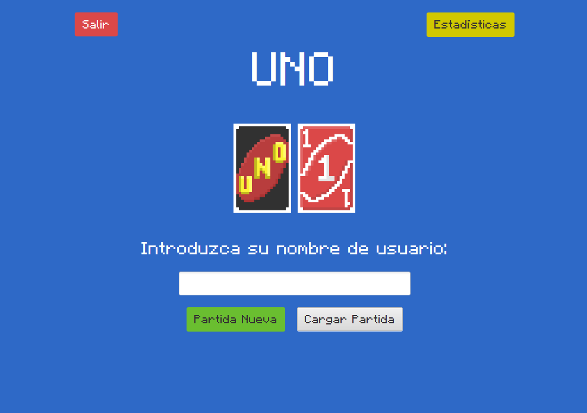
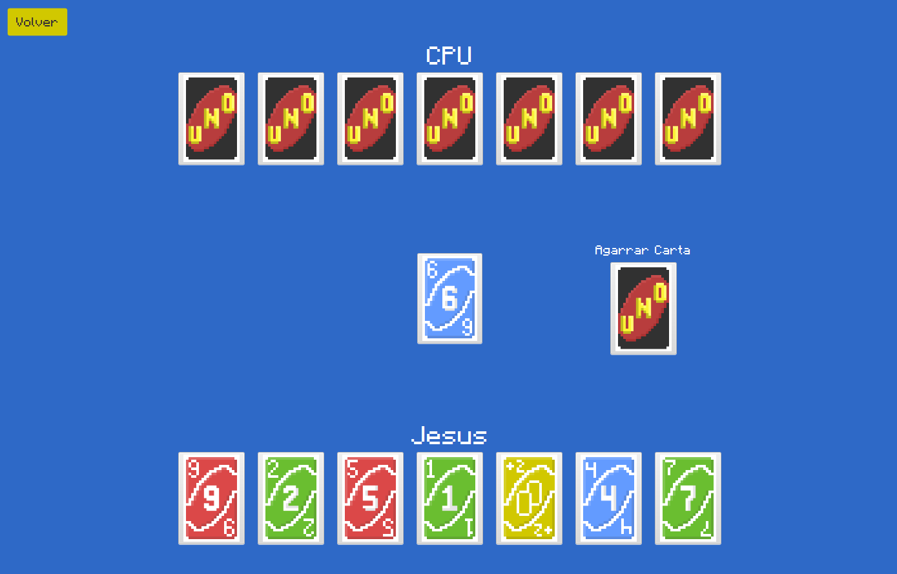

# 🃏 UNO Game - JavaFX Edition


Desarrollo integral del clásico juego **UNO**, construido desde cero utilizando Java 21 y fundamentado en principios sólidos de Programación Orientada a Objetos (POO). Este proyecto no solo abarca el motor de lógica del juego, sino que incluye una interfaz gráfica interactiva y moderna construida con **JavaFX**, brindando una experiencia inmersiva de escritorio.

## 👥 Equipo y mi rol

Proyecto en equipo de la UCAB. Además de trabajar en el código, diseñé el estilo visual del juego: las cartas y la interfaz con estética **8-bit**.

## 📸 Interfaz del Juego
| Pantalla de Inicio | Plena Partida |
|:---:|:---:|
|  |  |

## ✨ Características Principales
* **Motor Lógico Completo:** Implementación de todas las reglas del juego UNO (robos, reversas, saltos, comodines +4, etc.).
* **Interfaz Gráfica Atractiva:** GUI fluida desarrollada en JavaFX con elementos visuales diseñados a mano.
* **Persistencia de Datos:** Sistema de guardado del estado del juego y gestión de perfiles de usuario utilizando archivos `.json`.
* **Animaciones y Efectos:** Micro-interacciones integradas para enriquecer la jugabilidad y experiencia del usuario (UX).

## 🏗️ Arquitectura y Tecnologías
El proyecto sigue el patrón arquitectónico **Modelo-Vista-Controlador (MVC)**, dividiendo claramente la lógica del negocio, las interfaces de usuario y el manejo de eventos:
* **Lenguaje:** Java 21
* **Interfaz de Usuario:** JavaFX 21 (con controladores FXML)
* **Gestor de Dependencias:** Maven
* **Testing:** JUnit 5 (Júpiter)

## 🚀 Instalación y Ejecución Local

### Prerrequisitos
- [JDK 21](https://adoptium.net/) instalado y configurado en tu variable de entorno `JAVA_HOME`.

### Pasos de ejecución
1. Clona este repositorio:
   ```bash
   git clone https://github.com/jesusobando32/UNO-GAME.git
   cd UNO-GAME
   ```
2. Compila el proyecto utilizando el Maven Wrapper incluido:
   ```bash
   ./mvnw clean compile
   ```
3. Inicia la aplicación:
   ```bash
   ./mvnw javafx:run
   ```
